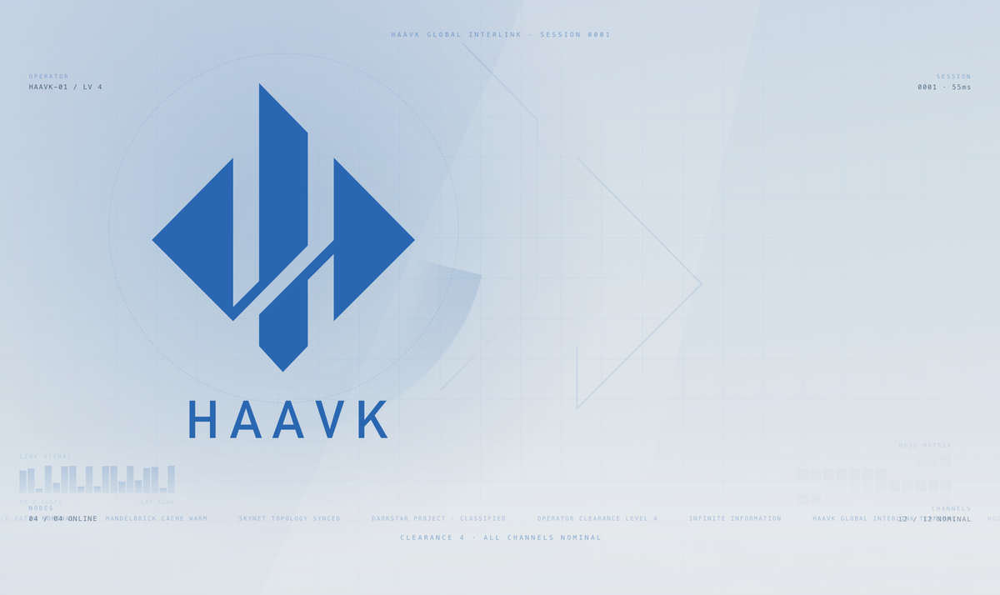
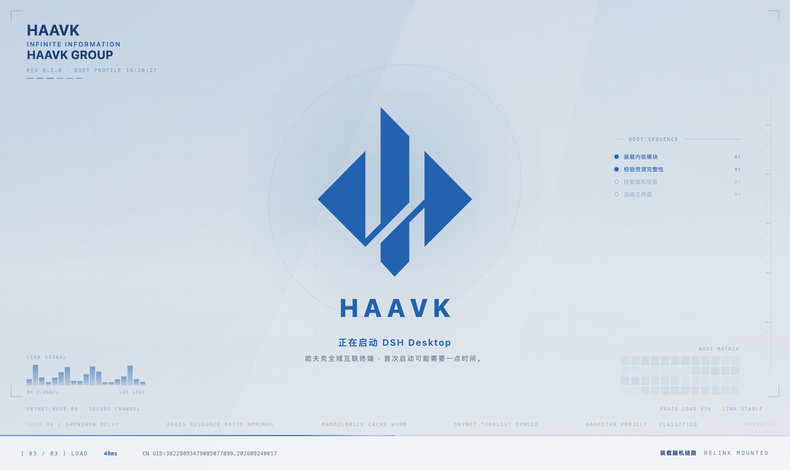
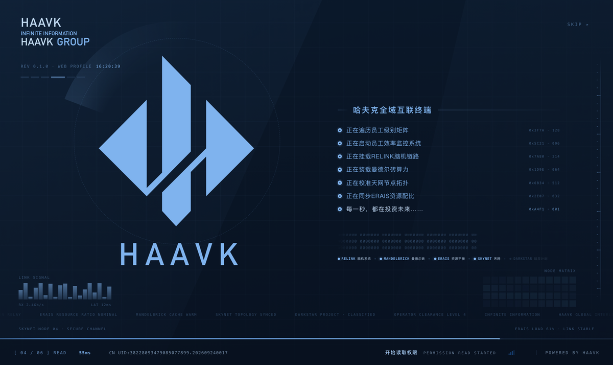

# 项目介绍

## 这是什么

`dsh-haavk` 是 **DeepSeek Harness（DSH）** 的启动界面插件。装上之后，每次冷启动
不再是直接看到空的聊天界面，而是先播一段完整的开机动画 —— 视觉参考《三角洲行动》里
哈夫克（HAAVK）阵营的「全域互联终端」，浅蓝白底、蓝色菱形徽记、右侧一列逐行点亮的
系统自检清单、底部一条细进度线和状态读数。

它不是一张静态启动图，而是一条有时序的序列：入场 → 自检 → 授权 → 收尾 → 换景，
每一步都有过程动画，且任何两幕之间都不允许出现"切屏"。


## 为什么做

原始的上游插件（见 [UPSTREAM-DIFF.md](UPSTREAM-DIFF.md)）是一套暖白「技术档案」底板 +
DeepSeek 鲸鱼标识的六幕授权序列，功能完整，但视觉与哈夫克阵营无关。这个仓库把主题层
整体重做，同时保留上游那套骨架（Host 注入、路由、设置面板、测试）。

改造过程中反复打磨的其实是**三件事**，文档里也就按这三件事来写：

1. **观感不能是拼接的** —— 一套色板、一套几何、一套节奏；
2. **不能有"卡顿感"** —— 用户感受到的卡顿往往不是掉帧，而是同帧改太多东西；
3. **结尾不能"啪一下消失"** —— 退场要像换景，不是关灯。



## 版式的来历

配色不是估的。把参考画面切成 12×8 网格逐格取色，避开文字墨迹（只统计亮度 ≥ 72 的
分位数），得到一组可以反解的数值：

| 位置 | 亮度 | 蓝差 `b-r` |
|---|---|---|
| 上缘 | ≈ 215 | +27 |
| 中段 | ≈ 222 | +18 |
| 底部 | ≈ 230 | +7 |

结论是：整幅只在**纵向**走一道很缓的「上冷下暖、上深下浅」，横向几乎不渐变 ——
横向再加强一点就会读成一张渐变卡，而不是真实终端画面。这三档值直接落成
`--p-plane-t` / `--p-plane-m` / `--p-plane-b`，斜切折光落成 `--p-facet-rgb`
（alpha 只有 0.07 / 0.04，参考画面里那道斜切本来就是白纸上的极淡折光）。

## 视觉语言

| 元素 | 作用 |
|---|---|
| 斜切几何面 + 4vw 网格 | 底板，几乎看不见但决定"是屏幕不是纸" |
| 四角刻度 + 右侧竖排标尺 | 让版心看起来被"标定"过 |
| 菱形徽记（46vh）+ 字标 | 主视觉，描边 → 落墨 → 呼吸 |
| 右侧八行清单 + 行尾读数 | 主信息流，逐字浮出、逐行点亮 |
| 左下 `LINK SIGNAL` 波形 | 填空白，兼作"系统在跑"的证据 |
| 右下 `NODE MATRIX` 状态格 | 同上，48 格随机呼吸 |
| 贯穿全底的滚动播报带 | 把视线往下带，避免下半屏发空 |
| 底部状态条 + 细进度线 | 传统终端读数：`[ 04 / 06 ] READ` · `55ms` · `CN UID` |
| 左上 HUD（品牌三行 / REV / 时钟 / 阶段格） | 上游原版那套读数，换配色继续用 |

## 技术结构

```
lib/index.js      Host 半：注册 5 条路由 + 往 index.html 注入样式与运行时
lib/splash.js     运行时：双序列（终端 runPortal / 回退 run）+ 计时引擎 + 音频
lib/splash.css    全部样式：根变量、回退序列、终端版式、结尾三态、深色变体
lib/client.js     浏览器半：设置面板（33 项）
desktop-shell/    桌面端原生层的四张页（插件注入不到，只能覆盖文件）
test/             5 套冒烟测试，共 262 项断言
preview/          离线预览页，不装插件也能看
```

- **零运行时依赖**：`dependencies` / `peerDependencies` 都是空的，装完不需要 `npm install`。
- **进度用 rAF 追目标值**，不是 CSS transition —— 步进只进不退，两幕之间还有一道
  渗流（每 380ms 蹭 5%）保证进度条不停在死点。
- **文字换内容走交叉淡入**：旧字就地包成残影飘走，新字新建元素浮上来，不清空、不重排。
- **逐帧动画只碰 `transform` / `opacity`**，常驻无限动画不挂 `will-change`。

## 实测

| 指标 | 数值 |
|---|---|
| 帧间隔（1072 帧采样，无头 Chrome） | p50 16.7ms / p99 16.8ms / 最差 16.8ms |
| 超过 20ms 的帧 | 0 |
| 淡出亮度曲线 | 单调，最大帧间跳变 4.56，无回跌、无闪黑 |
| 冒烟测试 | 五套全绿：59 / 70 / 40 / 45 / 48 |

> 说明：无头环境测不出掉帧，不等于用户感受不到卡顿。1.6.0 之所以从"掉帧"转向
> "节奏"，就是因为测出来帧率是干净的，而用户明确说"每一个过渡都有卡顿感" ——
> 真因是同帧改五六处内容 + 强制同步布局，修法只能是错峰与交叉淡入。

## 桌面端的一层

DSH Desktop 有两个启动画面：

| 层 | 文件 | 谁能改 |
|---|---|---|
| 网页层 | 插件注入的 `#dsh-startup-root` | 插件自己 |
| **原生层** | `Resources/splash.html` 等四张页 | 只能覆盖文件 |

原生层由 Electron 主进程 `showSplash()` 直接 `loadURL(file://...)`，插件注入不进去，
所以它在 1.7.0 之前一直是白底黑鲸鱼。`desktop-shell/` 里放的是改成同一套哈夫克语言的
四份文件（同一个 `MARK_PATH`、同一组 `--p-*` 变量、同样的描边 → 落墨 → 字标逐字母），
覆盖办法与注意事项见 [DESKTOP.md](../DESKTOP.md)。



## 深色变体

同一套版式，只换底板与字色（`--p-blue` → `#7fb3ee`，底板 → `#0b1a2d` 系），
几何、动效、时序完全一致。



## 许可与归属

代码与文案为本仓库原创部分采用 MIT（继承上游 `6shenhonghong9/dsh-haavk`，
原作者沈宏宏，署名保留）；哈夫克 / HAAVK /《三角洲行动》的标识与 `lib/assets/` 下音频
权利归原权利人（腾讯 / 天美工作室群）。本项目是粉丝向个人作品，与权利人无任何关联。
详见 [README 免责声明](../README.md#免责声明)。
